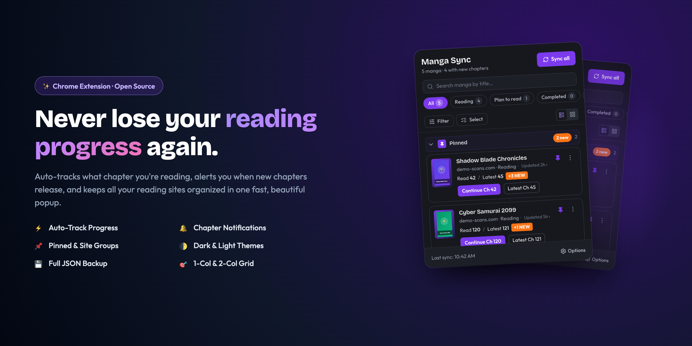
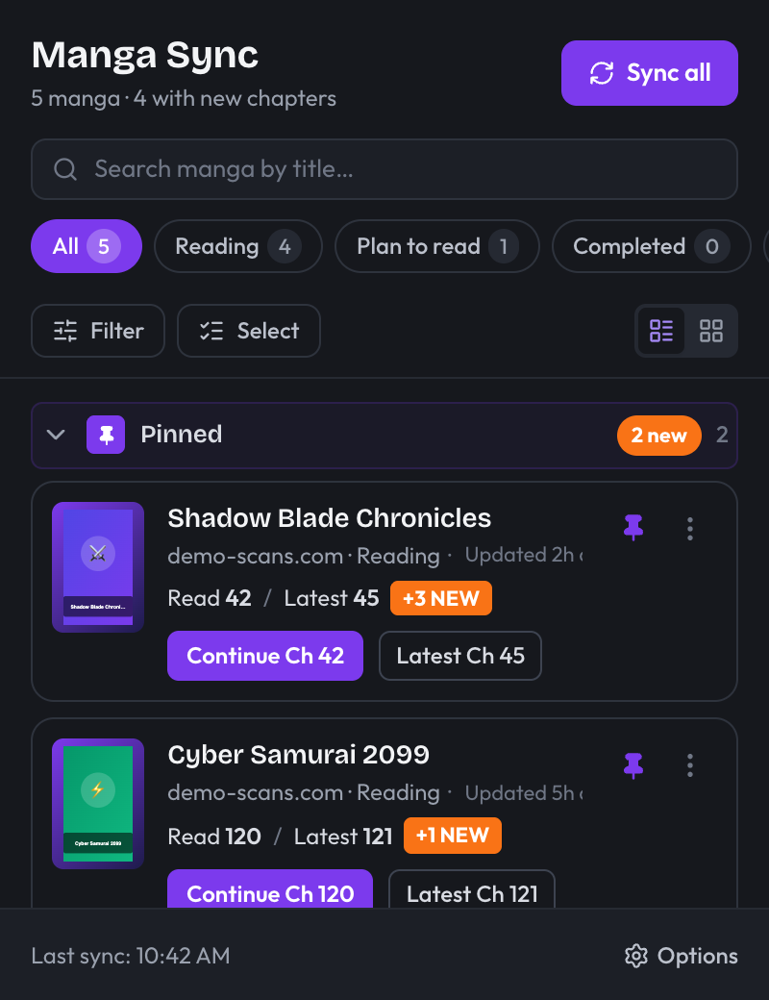
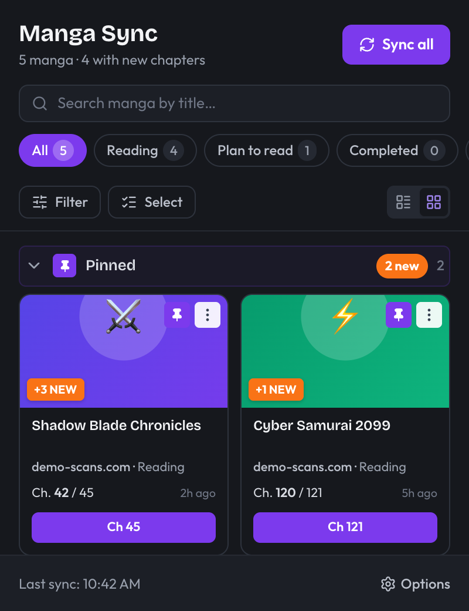
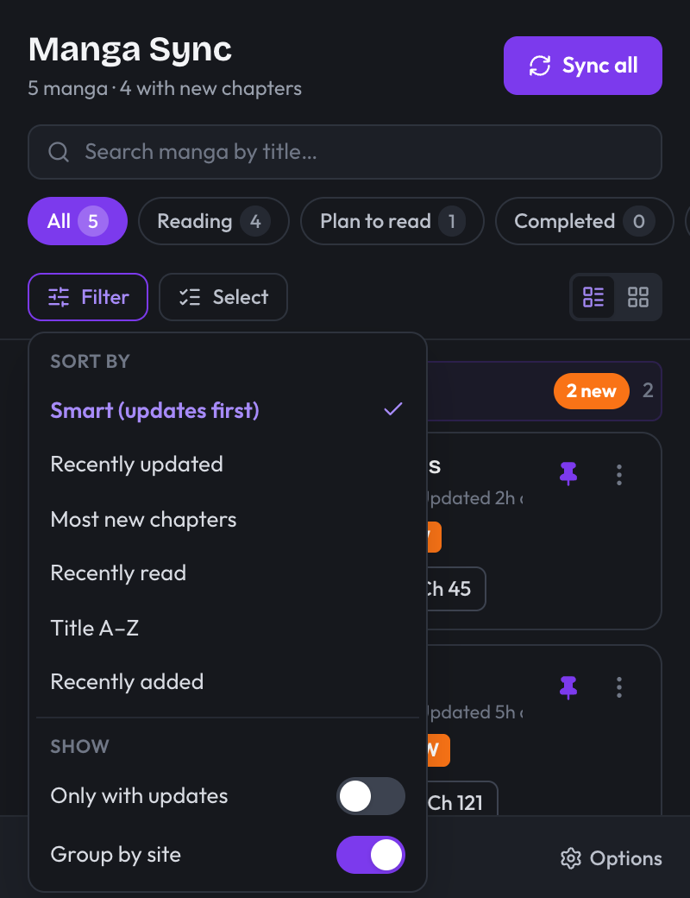
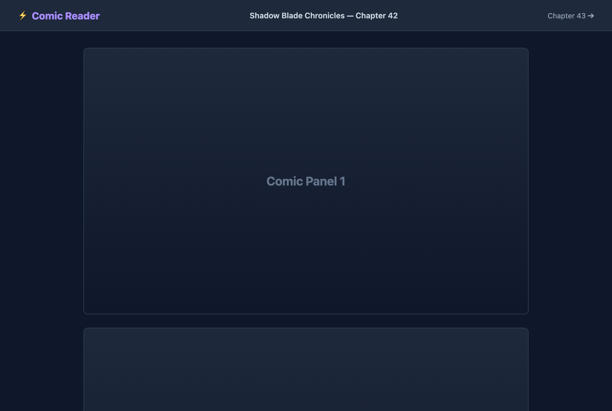
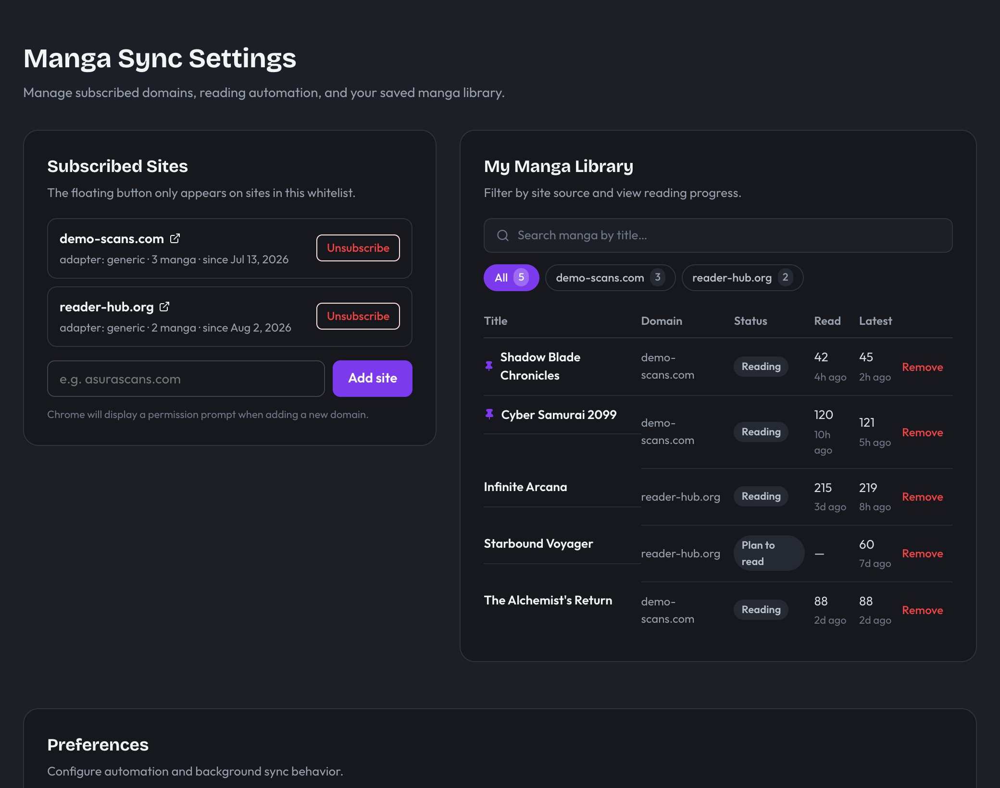

<p align="center">
  
</p>

<p align="center">
  <strong>The modern, privacy-first Chrome Extension that auto-tracks your reading progress across all comic and manga websites.</strong>
</p>

<p align="center">
  
  
  
  
  
  
</p>

---

## 🌟 Overview

Keeping track of chapter progress across multiple reading websites can quickly become chaotic with dozens of open tabs and forgotten bookmarks.

**Manga Sync** runs locally in your browser:
- 📖 **Automatically tracks reading progress** after 3 seconds on any chapter page.
- 🔔 **Desktop notifications and badge counters** alert you whenever new chapters are released.
- 🎯 **One unified popup** lets you jump straight into the next chapter or latest release across any site.
- 🛡️ **Privacy-first**: No external accounts, no telemetry, no tracking scripts. Your library stays 100% on your device with one-click JSON backup.

---

## 📸 Screenshots & Showcase

<table width="100%">
  <tr>
    <td width="50%" align="center">
      <strong>1-Column List View (Light)</strong><br />
      
    </td>
    <td width="50%" align="center">
      <strong>2-Column Grid View (Light)</strong><br />
      
    </td>
  </tr>
  <tr>
    <td width="50%" align="center">
      <strong>Dark Mode Theme</strong><br />
      
    </td>
    <td width="50%" align="center">
      <strong>Filter & Smart Sorting Popover</strong><br />
      
    </td>
  </tr>
  <tr>
    <td width="50%" align="center">
      <strong>In-Page Floating Action Button (FAB)</strong><br />
      
    </td>
    <td width="50%" align="center">
      <strong>Settings & Library Dashboard</strong><br />
      
    </td>
  </tr>
</table>

---

## ✨ Features

- ⚡ **Automatic Progress Tracking**: Opening a chapter automatically updates your reading history after 3 seconds. Progress only moves forward, so revisiting old chapters never lowers your tracked chapter.
- 📌 **Pin to Top**: Keep your favorite high-priority series pinned above all site groups.
- 🗂️ **Multi-Site Grouping**: Group reading items by domain or switch to a flat sorted view.
- 🎯 **1-Column & 2-Column Views**: Switch with one click between an action-rich list view and a visual grid card view.
- 🔍 **Instant Search & Multi-Sort**:
  - Filter titles in real-time.
  - Sort by: *Smart (updates first)*, *Recently updated*, *Most new chapters*, *Recently read*, *Title A–Z*, or *Recently added*.
- 🔔 **Chapter Release Notifications**:
  - Extension icon badge displays unread updates for items in your active reading list.
  - Periodic background sync triggers desktop notifications with direct links to new chapters.
- 🖱️ **Draggable Floating Action Button (FAB)**:
  - Appears only on subscribed reader websites.
  - Drag freely across the viewport with boundary clamping, or lock to any of the 4 screen corners.
  - Quick action shortcuts for **"Next Ch"** and **"Latest Ch"** directly on the reader page.
- 📋 **Bulk Actions & Multi-Select**:
  - Select multiple items to update status, mark as read, pin, mute, or remove simultaneously.
- ↩️ **Undo Remove**: Deleted an item by mistake? A toast banner lets you restore removed items with 1 click.
- 🔇 **Per-Item Mute**: Silence badge counts and notifications for specific series without removing them from your library.
- 💾 **JSON Backup (Export & Import)**: Export your entire library to a JSON file and restore it on another machine with conflict-free merging.
- 🌓 **Theme Support**: Seamless System, Light, and Dark mode support.
- 🛡️ **Explicit Whitelist Subscriptions**: Content scripts only run on domains you explicitly allow via the browser permission prompt.

---

## 🚀 Installation & Quick Start

### For Testers & Local Use

1. Clone or download this repository:
   ```bash
   git clone https://github.com/your-username/manga-sync.git
   cd manga-sync
   ```
2. Install dependencies and build the extension:
   ```bash
   pnpm install
   pnpm build
   ```
3. Open Google Chrome and navigate to:
   ```
   chrome://extensions
   ```
4. Enable **Developer mode** (toggle switch in the top right corner).
5. Click **"Load unpacked"** (Muat yang belum dibongkar) in the top left.
6. Select the **`dist/chrome-mv3`** folder inside this project directory.
7. Click the Extension puzzle icon in your Chrome toolbar and pin **Manga Sync**!

---

## 🛠️ Development Scripts

Built with **[WXT Framework](https://wxt.dev/)**, **React 19**, and **TypeScript**.

```bash
# Install dependencies
pnpm install

# Start development mode with hot module reloading
pnpm dev

# Type check TypeScript code
pnpm compile

# Run automated test suite (33 unit tests)
pnpm test

# Build production bundle (outputs to dist/chrome-mv3)
pnpm build

# Generate production .zip archive for Chrome Web Store
pnpm zip

# Re-generate promotional showcase screenshots
pnpm screenshots
```

---

## 🌐 Adding Site Adapters

Manga Sync uses a modular adapter architecture in `src/adapters/`:

1. Create a new adapter file in `src/adapters/mysite.ts`:
   ```ts
   import type { SiteAdapter } from '../core/types';

   export const mySiteAdapter: SiteAdapter = {
     id: 'mysite',
     matches(url) {
       return url.hostname === 'mysite.com' || url.hostname.endsWith('.mysite.com');
     },
     detectPage(url, doc) {
       // Extract slug, series title, chapter number from DOM / URL
     },
     parseSeries(html, seriesUrl) {
       // Parse latest chapters from fetched HTML
     },
   };
   ```
2. Register the adapter in `src/adapters/index.ts`. All sync logic, background alarms, and UI will automatically support the new site!

---

## 📦 How to Publish to Chrome Web Store

1. **Create a Developer Account**:
   - Visit the [Chrome Web Store Developer Dashboard](https://chrome.google.com/webstore/devconsole).
   - Sign in with your Google account and pay the one-time $5 USD registration fee.

2. **Generate the Extension Zip Package**:
   ```bash
   pnpm zip
   ```
   This creates a production `.zip` package in `.output/` ready for store upload.

3. **Store Listing Assets**:
   - **Icons**: 16x16, 32x32, 48x48, 128x128 (found in `public/icon/`).
   - **Promotional Tile (1280x800 / 1280x640)**: Upload `docs/screenshots/promo-banner.png`.
   - **Screenshots (1280x800)**: Upload `docs/screenshots/popup-list-light.png`, `docs/screenshots/popup-dark.png`, `docs/screenshots/reader-fab.png`, and `docs/screenshots/options-dashboard.png`.

4. **Permissions & Privacy Justification**:
   - **Single Purpose**: *"Track reading progress and chapter updates across user-whitelisted comic and manga websites."*
   - **Permissions**:
     - `storage`: Saves reading progress and user settings locally.
     - `scripting` & `optional_host_permissions`: Injects the floating progress button only on sites the user explicitly subscribes to.
     - `alarms`: Periodically checks for new chapter releases in the background.
     - `notifications`: Alerts the user when new chapters are available.
   - **Privacy Policy**: Explicitly mention that all data is stored on-device and no user data is collected or transmitted to external servers.

---

## 📄 License

Distributed under the [MIT License](LICENSE).
